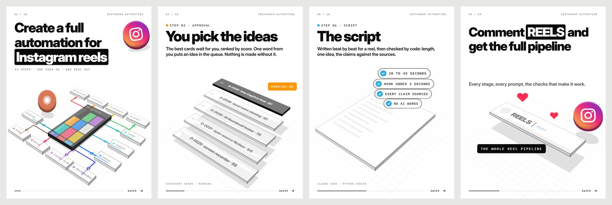
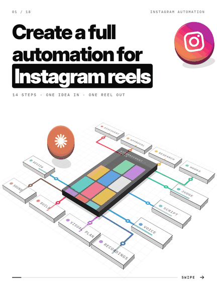
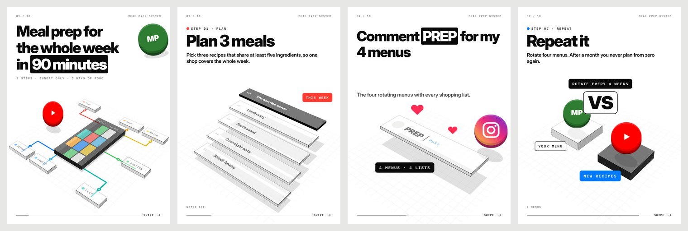
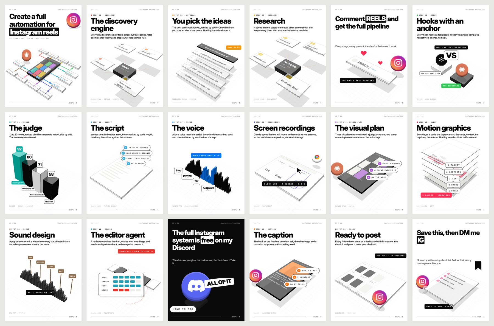

# claurosel-maker-3d

A Claude Code skill that makes 3D isometric carousels for Instagram, LinkedIn and X. Give Claude a topic and it writes the slides, picks
a 3D scene for each one, renders them as 1080x1440 PNGs ready to post, then checks its own work.



## Install

In Claude Code:

```
/plugin install claurosel-maker-3d --marketplace gabrielebolognese/claurosel-maker-3d
```

Older Claude Code, in two steps:

```
/plugin marketplace add gabrielebolognese/claurosel-maker-3d
/plugin install claurosel-maker-3d@claurosel-maker-3d
```

Without the plugin system: copy `skills/carousel-maker/` into `~/.claude/skills/`.

The renderer needs Python 3.10 or newer and Playwright, once:

```
python -m pip install playwright
python -m playwright install chromium
```

## Use

Just ask:

- "make a carousel about how I plan my content week, 10 slides, ask people to comment PLAN"
- "turn this blog post into a LinkedIn carousel"
- "carousel of the 6 tools I use every day, with their logos, last slide asks to save the post"

Claude asks only what it cannot guess (the steps, the platform, the call to action), writes the content, renders it, opens the overview
sheet, fixes anything cut off or crowded, and hands you the folder:

```
my-carousel/
  slides/slide-01.png ... slide-18.png   1080x1440, post them in order
  sheet.png                              every slide side by side
  carousel.html                          the source, open it in a browser
```



## Any niche

The look stays the same whatever the topic. This one is about meal prep, with its own letter logo:



## What it can draw

**20 scenes**, picked to match each step: a queue of cards, sources floating around a block, a gate that rejects a card, 3D bar charts,
a document with checks, two logos head to head, an audio waveform, a browser, a phone, stacked layers, a score card, a thread of posts,
a dial, a screen, a list with buttons, a network, a dashboard, a clock, a terminal log.

**4 call-to-action slides**: comment a keyword, DM a keyword, join a community, save the post. Put them anywhere in the carousel; each
one asks for something different.

**Logos as round 3D coins**: Instagram, X, YouTube, Claude, GitHub, Discord, Reddit, Chrome and more are built in. Add your own as an SVG
or as letters on your brand colour.

Every slide of the 18-slide example:



## How it works

Claude writes one JSON file (the title, the steps, a scene per step, the ad slides), and `make_carousel.py` draws every slide as
HTML and photographs it in Chromium. The format and every scene are documented in
[skills/carousel-maker/references/scenes.md](skills/carousel-maker/references/scenes.md), so you can also write or edit the JSON yourself:

```
python skills/carousel-maker/scripts/make_carousel.py --check skills/carousel-maker/examples/meal-prep.json
python skills/carousel-maker/scripts/make_carousel.py skills/carousel-maker/examples/meal-prep.json out/
```

The first command validates the file and names any mistake; the second writes the slides and the sheet into `out/`.

## License

MIT. The bundled fonts (Inter, IBM Plex Mono) are under the SIL Open Font License. The logos on the coins belong to their owners and
only refer to their products.
